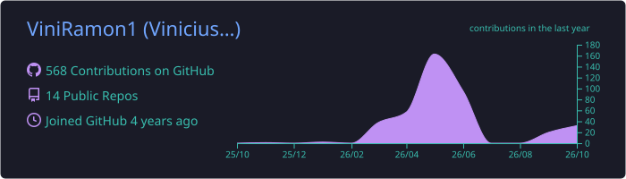
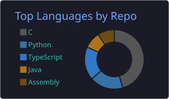
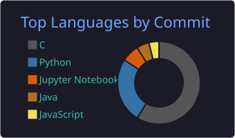
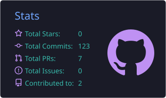
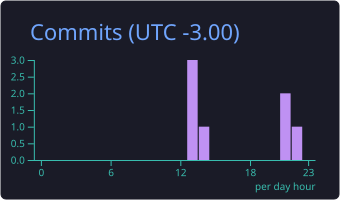

<div align="center">


<p>
  <a href="https://www.linkedin.com/in/viniramon1/"></a>
  <a href="mailto:viniciusramonn007@gmail.com"></a>
  <a href="https://www.instagram.com/vini_ramon013/"></a>
  <a href="https://x.com/ViniRamon1"></a>
</p>

</div>

## 👨‍💻 Sobre mim

```ts
const vinicius = {
  cargo: "Full Stack Developer @ BRISA",
  formacao: "Ciência da Computação — UFCA",
  local: "Juazeiro do Norte, CE 🇧🇷",
  diaADia: ["React", "NestJS", "TypeScript", "MongoDB", "PostgreSQL"],
  focoAtual: ["arquitetura limpa", "testes e CI/CD", "produto educacional"],
  curiosidades: ["computação gráfica com OpenGL", "programação concorrente"],
};
```

Hoje trabalho na **BRISA** construindo o **Arbo Educa**, uma plataforma educacional com vestibular online, provas, correção, missões e eventos para escolas e cursinhos. Atuo de ponta a ponta: API em **NestJS + MongoDB**, front em **React + Chakra UI**, segurança, QA e deploy.

## 🛠️ Stack

<p align="center">
  <a href="https://skillicons.dev">
    
    <br/>
    
    <br/>
    
  </a>
</p>

## 🚀 Projetos em destaque

| Projeto | Descrição | Stack |
| --- | --- | --- |
| 🌳 **Arbo Educa** <sub>(trabalho)</sub> | Plataforma educacional: vestibular online, provas com envio automático, correção, missões, eventos e grupos de tutoria | React · Chakra UI · NestJS · MongoDB · AWS S3 |
| 📊 **ProjectFlow** <sub>(em desenvolvimento)</sub> | Gerenciador de projetos colaborativo inspirado no MS Project: WBS, Gantt, dependências, recursos e linha de base | Next.js · NestJS · PostgreSQL |
| 🎨 [**paint_opengl**](https://github.com/ViniRamon1/paint_opengl) | Editor gráfico 2D com criação, seleção, transformações geométricas e undo/redo | C · OpenGL · GLUT |
| 🏎️ [**corrida3d_cg**](https://github.com/ViniRamon1/corrida3d_cg) | Jogo de corrida 3D feito para Computação Gráfica | C · OpenGL |
| 🧠 [**CPX**](https://github.com/ViniRamon1/CPX) | Processador de 16 bits baseado em MIPS, montado no Logisim | Assembly · Logisim |
| ⚡ [**BubbleSort**](https://github.com/ViniRamon1/BubbleSort) | Análise de ganho de desempenho do BubbleSort paralelo | C · OpenMP · OpenMPI |
| 🍝 [**Jantar dos Filósofos**](https://github.com/ViniRamon1/Jantar-dos-Filofosos) | O clássico problema de sincronização de Sistemas Operacionais | Python |

## 📊 Estatísticas

<div align="center">
  
  
  
  
  
</div>

<div align="center">
  
</div>

<div align="center">
  <picture>
    <source media="(prefers-color-scheme: dark)" srcset="https://raw.githubusercontent.com/ViniRamon1/ViniRamon1/output/github-snake-dark.svg"/>
    <source media="(prefers-color-scheme: light)" srcset="https://raw.githubusercontent.com/ViniRamon1/ViniRamon1/output/github-snake.svg"/>
    
  </picture>
</div>

---

<div align="center">
  
</div>
